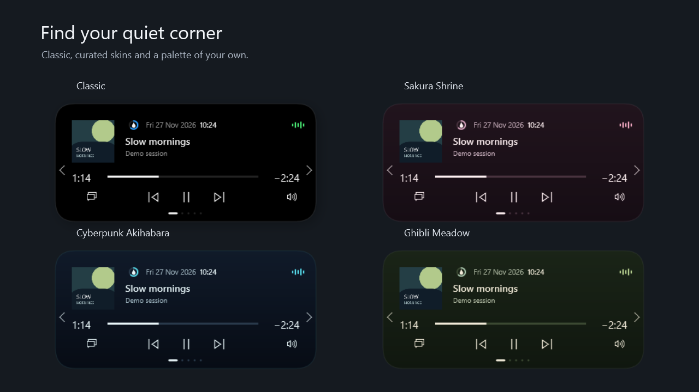

<p align="center"></p>
<h1 align="center">DeskPill</h1>
<p align="center"><strong><a href="https://github.com/RedRiotPapon/DeskPill/releases/latest/download/DeskPill-2.3.0-portable.zip">⬇ Download for Windows</a></strong> · <a href="https://github.com/RedRiotPapon/DeskPill/releases/latest">Release notes</a></p>
<p align="center"><a href="https://github.com/RedRiotPapon/DeskPill/releases"></a></p>
<p align="center">Music, shortcuts and everyday tools in a compact Windows notch.</p>
<p align="center">Windows 10/11 · Portable · Native WPF · MIT license</p>


## Make it yours

Live theme previews, **Classic and Glass**, seven colored skins, and your own custom palette. Adjust opacity, colors and finish. Preview notch size, width, corner shape and placement before saving. Tune hover delays and animation pace, then hide or reorder pages to suit your day.



## Features

| Feature | What you get |
| --- | --- |
| **Direct navigation** | Click a playing track to open its app or a uniquely matched browser tab. Switch notch pages with arrows, dots or the mouse wheel. |
| **Music controls** | Artwork, playback, seeking and a smooth system-volume slider. |
| **Notifications** | Quick previews, Open app, Copy, recent history and per-app interruption controls. |
| **Clipboard & OCR** | Search copied text, paste to your previous app, or extract text from a screen region. |
| **Offline dictation** | Choose lightweight Vosk or Parakeet Unified English, with CPU/GPU options for Parakeet. Hold **Ctrl+Space**, speak, release to insert. |
| **Focus & daily tools** | Work/break timers, tasks, hydration reminders and a file shelf for drag and drop. |
| **Game mode** | Optional translucent FPS bar; presentation tracing requires Windows trace access. |
| **Agents Home · Experimental** | Connect Codex, Claude or Gemini CLI for reviewed prompts and voice drafts. Codex supports reviewed screen images. Hide the page if you don’t use agents. |

## Get started

1. **[Download the ZIP](https://github.com/RedRiotPapon/DeskPill/releases/latest/download/DeskPill-2.3.0-portable.zip)**, extract it, and run `DeskPill.exe`. Keep `DeskPill.Speech.exe` beside it.
2. On first launch, choose **Set up dictation** or **Continue without dictation**. Setup is always available later.
3. Hover over the notch to open it. Use the arrows, dots or wheel to navigate.
4. Right-click the tray icon for **Settings** and **Start with Windows…**.

Requires .NET Framework 4.8. The portable app is unsigned. Dictation shows model requirements before an explicit download and must be enabled; it reserves Ctrl+Space while enabled. Startup and game mode are opt-in.

| Shortcut | Action |
| --- | --- |
| `Ctrl+Alt+Space` | Ask |
| `Ctrl+Alt+T` | Screen OCR |
| `Ctrl+Alt+V` | Clipboard search |
| `Ctrl+Space` | Hold to dictate, when enabled |

[Full guide](docs/GUIDE.md) · [Agent connections](docs/AGENTS.md) · [Music navigation](docs/MEDIA.md) · [Game mode](docs/GAMING.md) · [Capabilities & limits](docs/CAPABILITIES.md)

## Build

Requires Windows, .NET Framework 4.8 and Windows SDK metadata. No NuGet packages.

```powershell
.\build.ps1          # Build the app
.\build.ps1 -Test    # Build and run all suites
.\package.ps1        # Create the portable ZIP
```

[Contributing](CONTRIBUTING.md) · [Performance measurements](docs/PERFORMANCE.md) · [Third-party licenses](THIRD_PARTY_NOTICES.md)

Settings and connections stay in `%LOCALAPPDATA%\DeskPill`. Clipboard persistence is off by default; notifications and agent conversations stay in memory. Agent prompts go to the connected provider when sent. [Privacy & services](docs/GUIDE.md#privacy-and-optional-services).

If DeskPill is useful, give it a ⭐. [MIT licensed](LICENSE). All screenshots show DeskPill with demo data.
