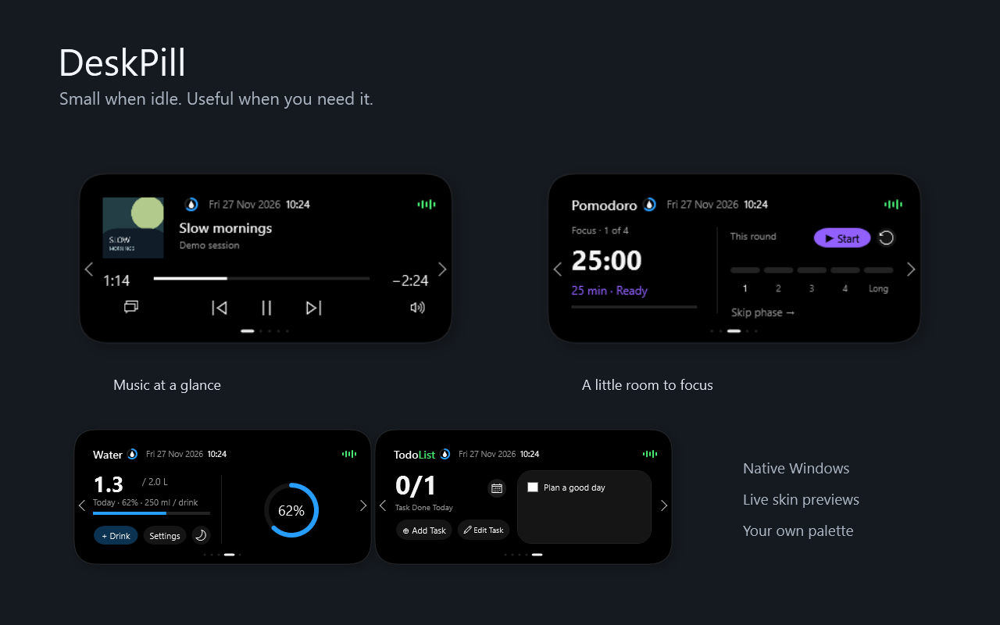

<p align="center"></p>
<h1 align="center">DeskPill</h1>
<p align="center">A quiet home for music, focus and everyday tools at the top of your Windows desktop.</p>
<p align="center">Windows 10/11 · Native WPF · .NET Framework 4.8 · MIT license</p>



DeskPill is a small desktop notch that expands when you need it. Control your music, start a focus session, hold files between apps, and glance at notifications without opening another dashboard.

## What it does

- **Music:** real Windows media sessions, artwork, playback controls and seeking.
- **Focus:** work/break timer with progress that survives restarts.
- **Shelf:** drop files to keep shortcuts handy, then open, copy or drag them into another app.
- **Tasks & water:** lightweight tasks and optional hydration tracking.
- **Windows notifications:** previews with Open app, Copy and Recent actions, app-level interruption controls, and an in-memory history of the last 50 arrivals.
- **Quick tools:** searchable clipboard history with keyboard selection and plain-text paste back to your previous app, screen OCR, calendar import, and an optional Gemini assistant.
- **English dictation:** optional offline speech to text with its own listening panel, Win+Space shortcut, cancellation and guarded paste. No separate app is required.
- **Personalization:** Classic plus seven skins, live theme preview, and your own six-color Custom palette with matte/satin finish and outline strength.

Hover intent waits at least 110 ms before opening and 130 ms before revealing options, helping brief pointer passes stay quiet. Click actions respond immediately.

The notch yields to occupied title-bar space, supports fullscreen hiding, and respects Windows reduced-motion settings. Startup is opt-in.

## Run it

Download the portable ZIP from [Releases](https://github.com/RedRiotPapon/DeskPill/releases/latest), extract it, and run `DeskPill.exe`. You can also build locally using the instructions below. No installer or additional app runtime is required on a system with .NET Framework 4.8.

1. Hover over the top-center notch to expand it.
2. Use the dots, arrows or mouse wheel to change pages.
3. Hover near the lower page dots for the page menu and Settings.
4. Right-click the notch or its tray icon for more tools and Exit.

| Shortcut | Action |
| --- | --- |
| `Ctrl+Alt+Space` | Open Ask |
| `Ctrl+Alt+T` | Select a screen region for OCR |
| `Ctrl+Alt+V` | Search clipboard history and paste to the previous app |
| `Win+Space` | Start/finish dictation, when enabled |

Shortcuts can conflict with other applications; the tray menu remains available. Settings also offers click-to-open mode, display selection, scale, position, page order and visibility. Hiding a page keeps its data.

## Quiet by choice

**Settings → Notifications** controls peek duration, focus/fullscreen behavior and apps allowed to show peeks. Quiet notifications remain in Recent; hiding DeskPill in fullscreen remains independent. Focus and fullscreen default to history only. These controls affect DeskPill, not Windows Do Not Disturb.

Use **Recent notifications** in the tray or right-click menu to review arrivals. Notifications received while you use a page wait without a 30-second expiry; only the newest eligible deferred arrival peeks afterward. History stays in memory and clears on exit.

**Settings → Pages** lets you hide unused pages and reorder the rest. Keep at least one visible.

## Optional English dictation

Open **Settings → Dictation**, install the speech pack (about 54 MB), enable dictation and save. Press **Win+Space** to start, speak, then press it again to finish. **Esc** discards the recording. A small listening panel shows the recording duration and responds to microphone input. The limit is 90 seconds.

While enabled, DeskPill takes over Win+Space, which Windows normally uses to switch input languages. Disabling dictation restores that shortcut. This is optional and off by default. No microphone capture runs while idle, and the speech model loads only for transcription in `DeskPill.Speech.exe`; that worker exits afterward to free its memory. Keep both executables together when extracting the portable ZIP.

Recognition runs locally using Vosk and a small English model. The first setup needs internet access; speech audio does not leave your PC and is not written to a recording file. If you switch apps before transcription finishes, DeskPill offers review instead of unexpectedly pasting into another app. Names, accents and punctuation can need correction. See [speech components and licenses](THIRD_PARTY_NOTICES.md).

## Make it yours


Open **Settings → Appearance** and select a skin to preview it immediately. **Save changes** keeps it; **Cancel** or closing Settings restores your saved look.

Choose **Custom** to edit shell, surface, accent, secondary, text and muted colors with hex inputs or color pickers. Change the finish and outline strength while watching the result. One Custom palette is saved locally.

## Build and test

You need Windows, .NET Framework 4.8 and Windows SDK metadata (`Windows.winmd`). The .NET desktop development workload and Windows SDK in Visual Studio Build Tools provide the development prerequisites. No NuGet packages are required.

```powershell
.\build.ps1            # Compile to bin/DeskPill.exe
.\build.ps1 -Test      # Build and run all test suites
.\package.ps1          # Create dist/DeskPill-1.2.1-portable.zip
```

The solution is also available as `DeskPill.sln`. Full UI, media and OCR probes require an interactive Windows desktop; CI runs the deterministic suites. See [CONTRIBUTING.md](CONTRIBUTING.md).

## Privacy and optional services

Settings and local state live in `%LOCALAPPDATA%\DeskPill`. File shelf entries store paths; removing one does not delete its file. Clipboard persistence is **off by default**. Notification text stays in memory.

Ask sends submitted prompts to Google when you configure your own Gemini key; the saved key uses Windows DPAPI for the current user. Weather, calendar URLs, lyrics and other online tools contact their respective services when used. Offline arithmetic does not require a key. No accounts, keys, personal state or telemetry configuration are included in this repository.

## Current limits

- Open app launches the registered source app, not the exact message. Inline replies are not supported. Esc dismisses the active preview even while another app has focus. Previews expire after the configured duration (six seconds by default); hovering pauses the countdown. Recent holds up to 50 arrivals for the current session, and deferred peeks coalesce to the newest eligible arrival.
- Clipboard history is text-only and does not yet support pinning. If Windows blocks focus or input to a target app, text stays copied for manual paste.
- Media controls depend on the source app exposing a Windows media session; brightness support depends on the display.
- OCR depends on Windows OCR language availability. Protected applications and unsupported accessibility trees may limit window overlap detection.
- ICS import does not expand recurring events. Optional services can require network access and provider credentials.
- The portable executable is unsigned. Frame callback pacing is measured locally; physical mixed-DPI monitor transitions still need broader hardware testing. See [performance measurements](docs/PERFORMANCE.md).

## Project layout

```text
src/DeskPill/       Application, Windows services and interface
assets/            Original app icon
scripts/           Optional developer tools
tests/             Domain, integration, UI and motion checks
docs/images/       Curated DeskPill images using isolated demo data
```

Bugs and focused pull requests are welcome. Include the Windows version, display scaling and reproduction steps. Keep reports free of private notification contents or API keys.

[MIT License](LICENSE). Images use demo data generated from DeskPill itself.

If DeskPill is useful to you, consider giving the repository a ⭐.
