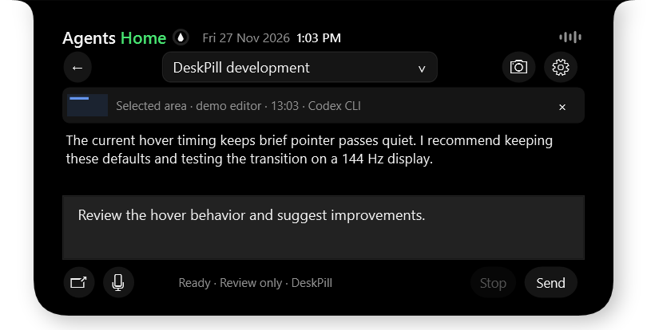
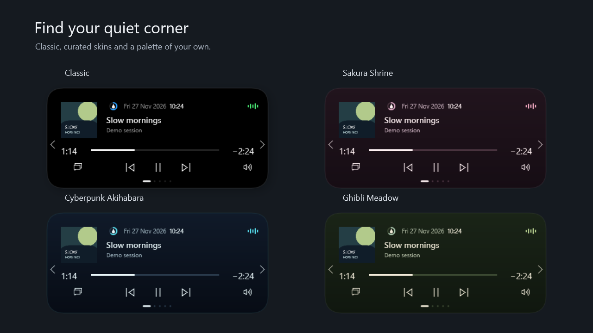

# DeskPill guide

[← Back to DeskPill](../README.md)

## Run it

Download the portable ZIP from [Releases](https://github.com/RedRiotPapon/DeskPill/releases/latest), extract it, and run `DeskPill.exe`. You can also build locally using the instructions below. No installer or additional app runtime is required on a system with .NET Framework 4.8.

1. Hover over the top-center notch to expand it.
2. Use the dots, arrows or mouse wheel to change pages.
3. Hover near the lower page dots for the page menu and Settings.
4. Right-click the notch or its tray icon for more tools and Exit.

| Shortcut | Action |
| --- | --- |
| `Ctrl+Alt+Space` | Open Ask |
| `Ctrl+Alt+T` | Select a screen region for OCR |
| `Ctrl+Alt+V` | Search clipboard history and paste to the previous app |
| `Win+Space` | Hold to speak, release to insert, when enabled |

Shortcuts can conflict with other applications; the tray menu remains available. Settings also offers click-to-open mode, display selection, scale, position, page order and visibility. Hiding a page keeps its data.

## Quiet by choice

**Settings → Notifications** controls peek duration, focus/fullscreen behavior and apps allowed to show peeks. Quiet notifications remain in Recent; hiding DeskPill in fullscreen remains independent. Focus and fullscreen default to history only. These controls affect DeskPill, not Windows Do Not Disturb.

Use **Recent notifications** in the tray or right-click menu to review arrivals. Notifications received while you use a page wait without a 30-second expiry; only the newest eligible deferred arrival peeks afterward. History stays in memory and clears on exit.

**Settings → Pages** lets you hide unused pages and reorder the rest. Keep at least one visible.

## Agents Home · Experimental



Agents Home is experimental. **Agents** is visible by default, including after upgrading. Use **Settings → Pages** to hide, restore or reorder it; hiding keeps your connections. Music and everyday tools work without setting up an agent.

Choose **Connect agent**, name the connection, pick its installed tool and project folder, then choose **Ask your agent…** or the microphone. Codex CLI, Claude Code and Gemini CLI adapters run separate sessions owned by DeskPill. Follow up in the same session, switch destinations without losing drafts, and use **Stop** to end that run. The home page’s manage menu offers edit, remove and new conversation. A quiet dot on the compact notch shows working, unread or attention states while Agents is visible; game mode suppresses it.

Connections default to **Review only**. Codex project edits require an explicit connection setting. Tools use their existing sign-in and billing. Install and authenticate your CLI separately; **Find installed CLI** supports native `.exe` tools and recognized official npm installations without executing batch shims. Gemini plan mode depends on the installed CLI’s capabilities.

For Antigravity, desktop/cloud tools or another agent without a supported connection, choose **App shortcut**. DeskPill offers **Copy prompt** and **Open app** for manual handoff. It does not discover or control that app’s existing conversations.

With the optional English speech pack installed, **hold the microphone button** (or focus it and hold Space), speak, and release to fill the draft. The waveform follows microphone input. Review your words, then click **Send** or press **Ctrl+Enter**. Esc cancels speech; another Esc returns to the page. Voice never dispatches a prompt automatically. Drafts and responses stay in memory and clear when DeskPill exits; connection profiles are saved locally. Provider tools may keep their own history. [Connection details and limits](AGENTS.md).

The conversation retains a bounded in-memory transcript. Use its **Conversation actions** gear to copy the latest answer, copy the conversation, start over, or explicitly paste the answer into the remembered source app. Paste checks the original window and process; if Windows refuses, the answer remains copied. It never presses Enter. Idle conversations can collapse while the tool keeps working; reopening preserves each agent’s draft.

For **Codex CLI**, the camera button attaches one reviewed screen image: select an area, the previous external window, or its monitor. A thumbnail shows the source, capture time and recipient. Click it to inspect or × to remove. The image goes to the selected tool only when you click **Send**. Window captures contain visible pixels and may include overlapping windows. Attachments remain separate per connection; successful sends and removal clean temporary files, while failed sends keep the draft available for retry. Provider history is managed by that provider.

Hold-to-talk stays the default. Right-click the mic or visit **Settings → Dictation** for click-to-start/stop. Enabled **Win+Space** fills the open agent draft for review; elsewhere it keeps normal dictation behavior. Missing speech assets open the optional setup page. Neither voice nor screenshots send themselves.

Agent completions can show a brief, silent clickable notice when the notch is idle. **Settings → Notifications** can disable these. Focus quiet settings, fullscreen, games, overlap and active editors suppress them; the status dot remains available when appropriate. No agent discovery, agent process, microphone or capture starts for ordinary users without an explicit connection or action.

## Music shortcuts

Click the **artwork or track title** to return to the playing app. Chrome, Edge, Brave, Vivaldi, Opera, Firefox and Chromium can select a matching accessible tab using the media title and artist. Tab selection needs a complete, unambiguous match; otherwise DeskPill brings the browser forward. It needs no browser extension or debugging port. [Matching details and limits](MEDIA.md).

The speaker button opens a continuous system-volume slider. Click along its track, drag, or use the arrow keys. It closes after 2.5 seconds without interaction, 450 ms after leaving, on an outside click or with Esc. Dragging keeps it open. Windows audio writes run in a shared background queue, preserving the final value when the flyout closes or reopens.

## Optional English dictation

Open **Settings → Dictation**, install the speech pack (about 54 MB), enable dictation and save. The tray menu also has a checked **Enable dictation · Win+Space** option; **Start / stop dictation** is available once enabled. Installing the speech pack alone does not enable the shortcut. Hold **Win+Space** while speaking, then release to transcribe and insert your words. **Esc** discards the recording. The notch itself shows the duration, an animated microphone and a waveform driven by actual microphone input; no listening window opens. If you switch apps, review stays inside the notch. The limit is 90 seconds.

While enabled, DeskPill takes over Win+Space, which Windows normally uses to switch input languages. Disabling dictation restores that shortcut. This is optional and off by default. No microphone capture runs while idle, and the speech model loads only for transcription in `DeskPill.Speech.exe`; that worker exits afterward to free its memory. Keep both executables together when extracting the portable ZIP.

Recognition runs locally using Vosk and a small English model. The first setup needs internet access; speech audio does not leave your PC and is not written to a recording file. If you switch apps before transcription finishes, DeskPill offers review instead of unexpectedly pasting into another app. Names, accents and punctuation can need correction. See [speech components and licenses](../THIRD_PARTY_NOTICES.md).

## Make it yours



Open **Settings → Appearance** and select a skin to preview it immediately. **Save changes** keeps it; **Cancel** or closing Settings restores your saved look.

**Classic stays the default. Glass is directly after it.** Select Glass to reveal opacity (35–95%) and highlight controls. Lettering stays opaque while the shell becomes translucent. Glass uses a tint and highlight, without background blur; very low opacity can reduce contrast over bright apps. Changes preview immediately and Cancel restores your saved look.

Choose **Custom** to edit shell, surface, accent, secondary, text and muted colors with hex inputs or color pickers. Change the finish and outline strength while watching the result. One Custom palette is saved locally.

## Optional game glass and FPS

Right-click the **tray icon → Game mode · glass & FPS** to enable the overlay, or use **Settings → Gaming**. While a detected game is foreground, the compact bar uses a quiet Glass surface at 22% opacity. With Game mode off, detected games tuck the notch into its tiny state. It passes mouse input through to the game, displays FPS when available, and restores your saved theme afterward. Automatic detection looks for fullscreen graphics apps; add explicit game executable names for reliable matching and windowed games. You can disable heuristic detection and use only your list.

The optional 1 MB PresentMon component measures game presentation intervals. **Windows requires administrator or Performance Log Users trace access**; Settings explains setup. DeskPill does not grant permissions, request elevation or inject into games. Without access or fresh data, the bar shows **FPS —**. Protected games and exclusive fullscreen can limit tracing or visibility. [Game mode details](GAMING.md).

## Build and test

You need Windows, .NET Framework 4.8 and Windows SDK metadata (`Windows.winmd`). The .NET desktop development workload and Windows SDK in Visual Studio Build Tools provide the development prerequisites. No NuGet packages are required.

```powershell
.\build.ps1            # Compile to bin/DeskPill.exe
.\build.ps1 -Test      # Build and run all test suites
.\package.ps1          # Create dist/DeskPill-2.1.4-portable.zip
```

The solution is also available as `DeskPill.sln`. Full UI, media and OCR probes require an interactive Windows desktop; CI runs the deterministic suites. See [CONTRIBUTING.md](../CONTRIBUTING.md).

## Privacy and optional services

Settings and local state live in `%LOCALAPPDATA%\DeskPill`. File shelf entries store paths; removing one does not delete its file. Clipboard persistence is **off by default**. Notification text stays in memory. Agent connection profiles store tool and project paths; DeskPill does not persist agent drafts, responses or session identifiers.

Agent prompts and project context go to the selected CLI and its configured provider when you press Send. DeskPill does not read provider credentials or grant requested permissions.

Ask sends submitted prompts to Google when you configure your own Gemini key; the saved key uses Windows DPAPI for the current user. Weather, calendar URLs, lyrics and other online tools contact their respective services when used. Offline arithmetic does not require a key. No accounts, keys, personal state or telemetry configuration are included in this repository.

## Current limits

- Open app launches the registered source app, not the exact message. Inline replies are not supported. Esc dismisses the active preview even while another app has focus. Previews expire after the configured duration (six seconds by default); hovering pauses the countdown. Recent holds up to 50 arrivals for the current session, and deferred peeks coalesce to the newest eligible arrival.
- Clipboard history is text-only and does not yet support pinning. If Windows blocks focus or input to a target app, text stays copied for manual paste.
- Media controls depend on the source app exposing a Windows media session; brightness support depends on the display.
- OCR depends on Windows OCR language availability. Protected applications and unsupported accessibility trees may limit window overlap detection.
- ICS import does not expand recurring events. Optional services can require network access and provider credentials.
- The portable executable is unsigned. Frame callback pacing is measured locally; physical mixed-DPI monitor transitions still need broader hardware testing. See [performance measurements](PERFORMANCE.md).

## Project layout

```text
src/DeskPill/       Application, Windows services and interface
assets/            Original app icon
scripts/           Optional developer tools
tests/             Domain, integration, UI and motion checks
docs/images/       Curated DeskPill images using isolated demo data
```

Bugs and focused pull requests are welcome. Include the Windows version, display scaling and reproduction steps. Keep reports free of private notification contents or API keys.

[MIT License](../LICENSE). Images use demo data generated from DeskPill itself.

If DeskPill is useful to you, consider giving the repository a ⭐.

Saved preferences and agent connections live in `%LOCALAPPDATA%\DeskPill\state.json`. Saves retain a last-good `state.json.bak` for recovery; this backup excludes clipboard history. Preview/capture modes read settings without writing to the normal profile. Conversation messages and drafts remain in memory.
